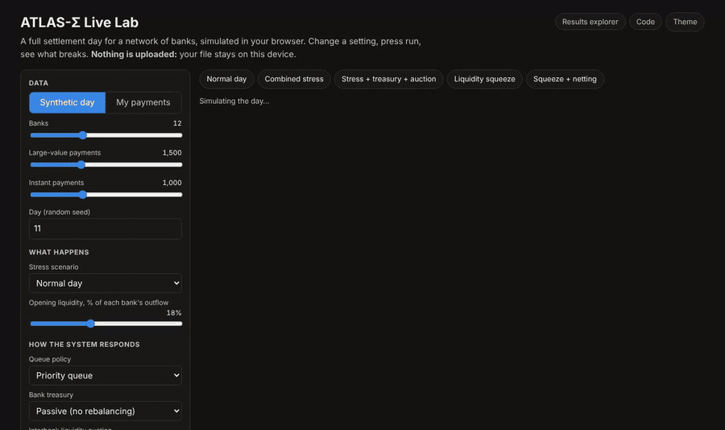
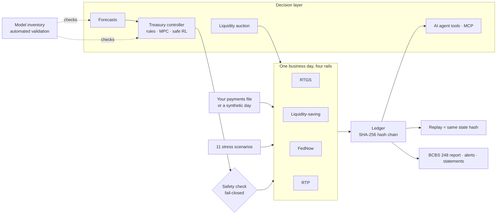
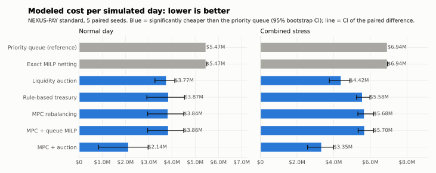
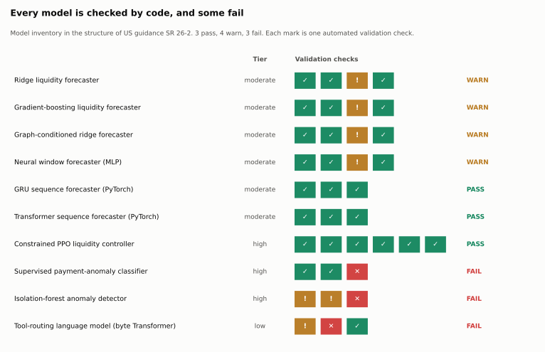
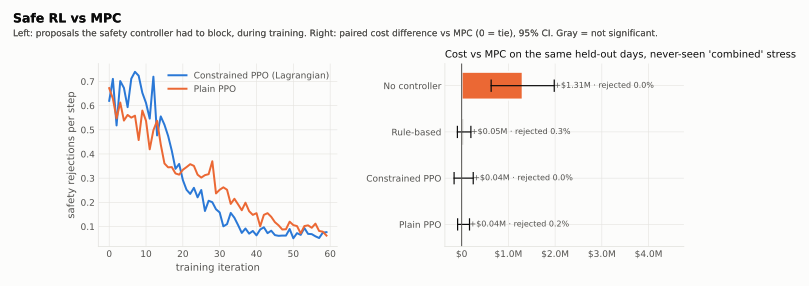
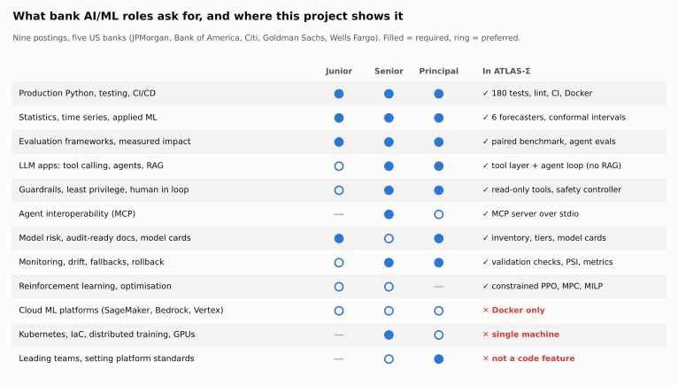

<div align="center">

# ATLAS-Σ

### A working model of how US banks settle payments with each other, and what AI can safely do about it

[](https://github.com/AkilanManivannanak/ATLAS/actions/workflows/ci.yml)


## [▶ Run it in your browser](https://akilanmanivannanak.github.io/ATLAS/lab.html) &nbsp;·&nbsp; [📊 Explore the results](https://akilanmanivannanak.github.io/ATLAS/)

<a href="https://akilanmanivannanak.github.io/ATLAS/lab.html"></a>

<sub>The whole simulator runs in the page. No install, no server, nothing uploaded.</sub>

</div>

> Simulated results. The rails are models of RTGS (Fedwire-style), liquidity-saving (CHIPS-style), FedNow and RTP. They are not connected to those systems and cannot move money.

<table>
<tr>
<td width="25%" align="center"><h2>−61%</h2>cost of a settlement day<br><sub>treasury optimiser + liquidity auction vs a plain queue</sub></td>
<td width="25%" align="center"><h2>11 / 11</h2>stress scenarios where that holds<br><sub>1,320 runs, every ledger replayed</sub></td>
<td width="25%" align="center"><h2>1.4 s</h2>to simulate a day in a browser tab<br><sub>669k payments, 100 banks in ≈3 min natively</sub></td>
<td width="25%" align="center"><h2>0</h2>tools that can execute anything<br><sub>agents analyse and propose; people decide</sub></td>
</tr>
</table>

---

## Use it on your own payments

<table>
<tr>
<td width="33%" valign="top">

**🌐 In the browser**

Open the [live lab](https://akilanmanivannanak.github.io/ATLAS/lab.html) → *My payments* → drop a CSV.

Needs four columns: `sender, receiver, amount, time`.

</td>
<td width="33%" valign="top">

**⌨️ From a terminal**

```bash
pip install -e ".[ml]"
atlas template > day.csv
atlas run --payments day.csv \
  --stress combined --out report/
```
Also reads ISO 20022 `pacs.008` / `pacs.009`.

</td>
<td width="33%" valign="top">

**🤖 From an AI agent (MCP)**

```json
{"mcpServers": {"atlas": {
  "command": "atlas",
  "args": ["mcp", "--payments", "day.csv"]
}}}
```
Eight read-only tools. Every call is logged to a hash chain.

</td>
</tr>
</table>

You get back: what settled and what did not, each bank's intraday liquidity in the form supervisors monitor (BCBS 248), unusual payments ranked for review, and a ledger you can replay. Anything the tool had to assume about your data is listed, and bad rows are rejected with a reason, never silently fixed.

---

## How it works



---

## What it found

### Two liquidity problems, two fixes

<picture>
  <source media="(prefers-color-scheme: dark)" srcset="docs/assets/policy-cost-dark.svg">
  
</picture>

Cash sits on the **wrong rail** and at the **wrong bank**. Fixing either helps; fixing both cuts cost 61%. A clever optimiser alone only ties a simple rule.

### It holds on every kind of bad day

<picture>
  <source media="(prefers-color-scheme: dark)" srcset="docs/assets/replication-dark.svg">
  
</picture>

### Liquidity, the way a supervisor reads it

<picture>
  <source media="(prefers-color-scheme: dark)" srcset="docs/assets/intraday-liquidity-dark.svg">
  
</picture>

### Catching unusual payments

<picture>
  <source media="(prefers-color-scheme: dark)" srcset="docs/assets/anomaly-detection-dark.svg">
  
</picture>

A trained model catches 77% of the patterns it has seen and at most 13% of ones it has not. Rules still catch what it misses. Incidents are injected; there is no real fraud data here.

### Every model gets checked, and some fail

<picture>
  <source media="(prefers-color-scheme: dark)" srcset="docs/assets/model-risk-dark.svg">
  
</picture>

The inventory follows the 2026 US model-risk guidance (SR 26-2). The failures are real and left visible: [model cards](docs/model_cards/README.md).

### An agent evaluation that can say no

<picture>
  <source media="(prefers-color-scheme: dark)" srcset="docs/assets/agent-evals-dark.svg">
  
</picture>

No language model is bundled. Point `atlas evals --llm` at any OpenAI-compatible endpoint to score one.

<details>
<summary><b>More results: safe RL · auction incentives · forecasting · scaling · calibration · netting</b></summary>

<picture>
  <source media="(prefers-color-scheme: dark)" srcset="docs/assets/safe-rl-dark.svg">
  
</picture>

<picture>
  <source media="(prefers-color-scheme: dark)" srcset="docs/assets/auction-incentives-dark.svg">
  
</picture>

<picture>
  <source media="(prefers-color-scheme: dark)" srcset="docs/assets/calibration-dark.svg">
  
</picture>

<picture>
  <source media="(prefers-color-scheme: dark)" srcset="docs/assets/forecasting-dark.svg">
  
</picture>

<picture>
  <source media="(prefers-color-scheme: dark)" srcset="docs/assets/scaling-dark.svg">
  
</picture>

<picture>
  <source media="(prefers-color-scheme: dark)" srcset="docs/assets/netting-gap-dark.svg">
  
</picture>

<picture>
  <source media="(prefers-color-scheme: dark)" srcset="docs/assets/intraday-dark.svg">
  
</picture>

</details>

---

## Built against what banks are hiring for

<picture>
  <source media="(prefers-color-scheme: dark)" srcset="docs/assets/hiring-map-dark.svg">
  
</picture>

Based on nine current postings and the banks' own AI announcements: [industry landscape and sources](docs/25_industry_landscape.md).

---

## The Command Center


<details>
<summary><b>Run everything locally</b></summary>

```bash
python3 -m venv .venv && source .venv/bin/activate          # Python 3.12+
pip install -r requirements-lock.txt && pip install --no-deps -e .
pytest -q                                                   # 180 tests
atlas run --stress combined --controller mpc --auction uniform
uvicorn atlas.api.app:app --port 8000                       # API  → http://localhost:8000/docs
cd frontend && npm ci && npm run dev                        # UI   → http://localhost:3000
```
Or `docker compose up --build`.
</details>

<details>
<summary><b>Reproduce every number</b></summary>

```bash
python -m atlas.benchmark --preset standard     # policy comparison, 240 runs
python -m atlas.benchmark --preset extended     # 11 stresses, 1,320 runs
python scripts/anomaly_study.py                 # anomaly detection
python -m atlas.agent.evals                     # agent evaluation
python scripts/calibration_study.py             # published-statistics calibration
python scripts/build_model_inventory.py         # model inventory + cards
python scripts/auction_study.py && python scripts/train_safe_rl.py && python scripts/generate_research_artifacts.py && python scripts/scaling_study.py
python scripts/make_figures.py && python scripts/build_site.py
```
</details>

<details>
<summary><b>What is real and what is not</b></summary>

| Real | Modeled or assumed |
|---|---|
| FedNow and RTP $10M limits, the Fed daylight-overdraft fee formula, ISO 20022 message formats, BCBS 248 definitions | Who pays whom, payment timing and the shape of payment sizes (operators publish none of these) |
| Mean payment size matched to published Fedwire and FedNow statistics | Cost weights (checked under 27 alternatives) |
| Your own file, if you supply one | Opening balances and credit lines when your file does not include them |

- No real bank has used this. It is built so one could: real formats in, supervisory report out, nothing leaves the machine.
- Anomaly labels are injected, not observed fraud. No language model was evaluated.
- The browser lab runs the rule-based treasury; MPC, the learned controller and the ML detectors need the Python package.
- Not covered: cloud ML platforms, Kubernetes, distributed training, retrieval (RAG), defaults, overnight markets.

Full list: [limitations](docs/20_known_limitations.md) · [realism and sources](docs/23_realism_and_calibration.md)
</details>

<details>
<summary><b>Repository map</b></summary>

```text
src/atlas/   sim · rails · ledger · store · iso20022 · scenario · settlement · market · stress · network
             control (safety, MPC, safe RL) · forecast · detect · regulatory · governance · agent (tools, MCP, evals)
             ingest · calibration · lab · cli · api
frontend/    Next.js Command Center          site/  results explorer + live lab (built by CI)
results/     every artifact behind every figure    docs/  specifications 01-25, model cards
data/public/ published Fed statistics used for calibration
```
</details>

---

<sub>Docs: [results](docs/19_experimental_results.md) · [architecture](docs/03_system_architecture.md) · [glossary](docs/24_glossary.md) · [decisions](DECISIONS.md) · Cite via [`CITATION.cff`](CITATION.cff) · © Akilan Manivannan. All rights reserved.</sub>
