<div align="center">

# ATLAS-Σ

### A deterministic digital twin of multi-rail payment infrastructure

**Simulate a full banking day across RTGS, liquidity-saving and instant-payment rails. Break it with stress scenarios. Test whether optimizers, auctions and reinforcement learning can settle more value with less liquidity. Replay every cent from a tamper-evident ledger.**

[](https://github.com/AkilanManivannanak/ATLAS/actions/workflows/ci.yml)


[**Interactive results explorer →**](https://akilanmanivannanak.github.io/ATLAS/) · [Results](docs/19_experimental_results.md) · [Architecture](docs/03_system_architecture.md) · [Realism & sources](docs/23_realism_and_calibration.md) · [Limitations](docs/20_known_limitations.md)

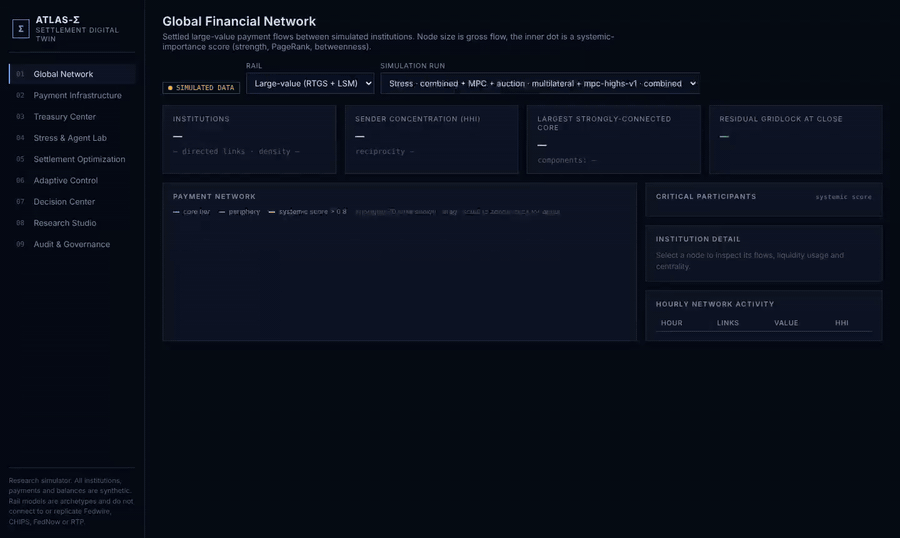

</div>

> **Research simulator. All data is synthetic.** ATLAS-Σ does not connect to, replicate, or claim the internal rules of Fedwire, CHIPS, FedNow or RTP, and it cannot execute payments. Public facts it uses (limits, fee formulas, hours) are cited in [`docs/23`](docs/23_realism_and_calibration.md).

---

## The 30-second version

<table>
<tr>
<td width="25%" align="center"><h2>−61%</h2>modeled daily cost<br><sub>MPC + liquidity auction vs priority queue, normal days</sub></td>
<td width="25%" align="center"><h2>99.55%</h2>of large-value value settled<br><sub>vs 97.33% for the priority queue</sub></td>
<td width="25%" align="center"><h2>297 / 297</h2>stress × cost-model cells where it ranks first<br><sub>11 stresses × 27 cost weightings, 10 seeds</sub></td>
<td width="25%" align="center"><h2>669k</h2>payments in one simulated day<br><sub>100 banks, ≈3 min on one CPU core, replay-verified</sub></td>
</tr>
</table>

**What we learned (on synthetic data):**

- 🔀 **Liquidity has two problems, not one.** Cash sits on the *wrong rail* (fixed by cross-rail rebalancing) and at the *wrong bank* (fixed by an intraday liquidity auction). Each lever alone helps; together they settle 99.55% of value.
- ⚖️ **A fancy optimizer alone is not enough.** MPC ties a simple rule-based treasury desk. The edge comes from adding a market for liquidity.
- 🧮 **Queue algorithms barely matter at realistic liquidity.** Exact MILP netting equals the plain priority queue unless the system is gridlocked.
- 🤖 **Safe RL matches MPC, with 0% safety violations**, on held-out days and on stress scenarios it never trained on. It does not beat MPC.
- 🎯 **Pay-as-bid auctions invite manipulation; uniform price resists it**, measured empirically on paired seeds.

---

## How it works

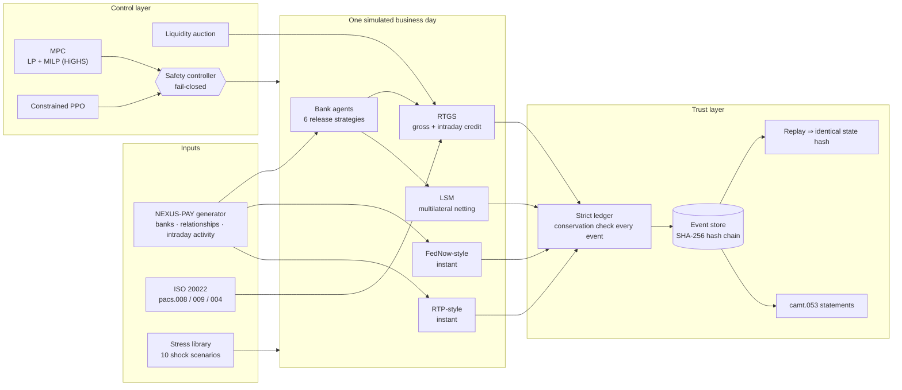

<details>
<summary><b>Lifecycle of one payment (click to expand)</b></summary>

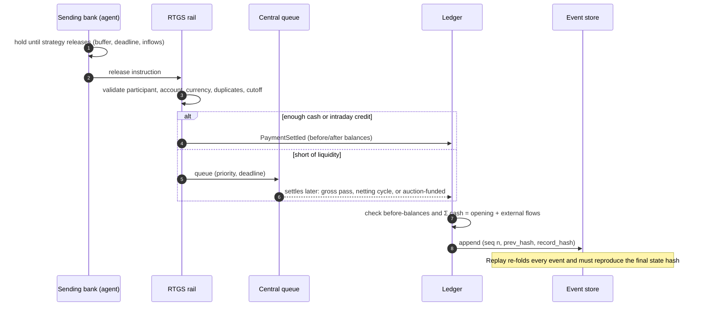
</details>

<details>
<summary><b>The safety contract every automated decision passes (click to expand)</b></summary>

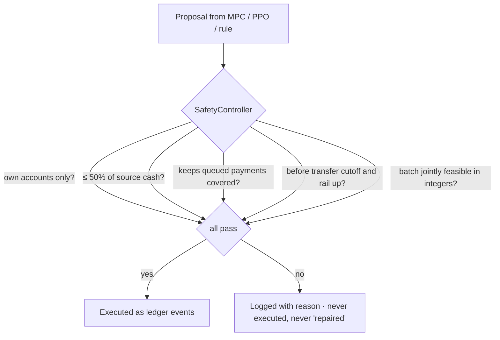
</details>

---

## Results at a glance

### 1. Which policy settles the most for the least?

<picture>
  <source media="(prefers-color-scheme: dark)" srcset="docs/assets/policy-cost-dark.svg">
  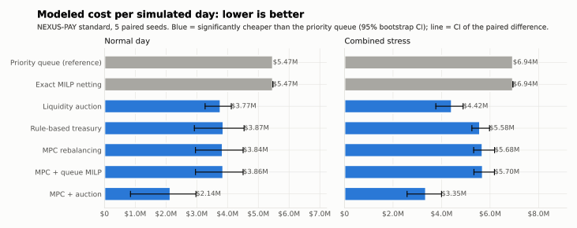
</picture>

<details>
<summary><b>Full table: normal day vs combined stress</b></summary>

| Arm | Normal: cost | Settled | Instant rejected | Combined stress: cost | Settled |
|---|---:|---:|---:|---:|---:|
| Priority queue (reference) | $5.47M | 97.33% | 89.2 | $6.94M | 97.03% |
| Exact MILP netting | $5.47M | 97.33% | 89.2 | $6.94M | 97.03% |
| Rule-based treasury | $3.87M | 98.36% | 6.6 | $5.58M | 97.85% |
| MPC rebalancing | $3.84M | 98.37% | 5.2 | $5.68M | 97.75% |
| Liquidity auction | $3.77M | 98.57% | 89.2 | $4.42M | 98.87% |
| **MPC + auction** | **$2.14M** | **99.55%** | **1.6** | **$3.35M** | **99.39%** |

5 paired seeds × 4 stresses × 12 arms = 240 runs, all replay-verified. Paired 95% bootstrap CIs are in [`results/benchmarks/standard.md`](results/benchmarks/standard.md). Trade-off: MPC + auction uses ≈49% more peak intraday credit (mostly collateralized).
</details>

### 2. Does it hold on every kind of bad day?

<picture>
  <source media="(prefers-color-scheme: dark)" srcset="docs/assets/replication-dark.svg">
  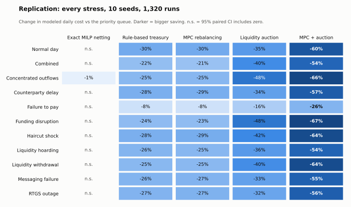
</picture>

Replicated on **10 seeds × 11 stress scenarios** (1,320 runs, all replay-verified). MPC + auction is significantly cheaper than the priority queue in **11 / 11** stresses (−26% to −67%, wins on every seed) and beats the rule-based treasury in all 11 (−$1.7M to −$4.8M per day). MPC alone ties the rule-based treasury in 10 / 11 and is slightly worse under liquidity hoarding. Exact netting changes nothing. Full tables: [`results/benchmarks/extended.md`](results/benchmarks/extended.md).

### 3. The same stressed day, two treasuries

<picture>
  <source media="(prefers-color-scheme: dark)" srcset="docs/assets/intraday-dark.svg">
  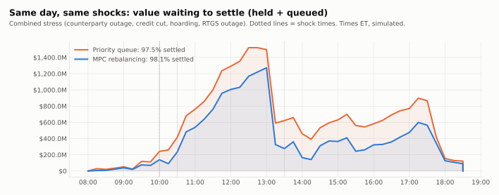
</picture>

### 4. Can a learned policy be trusted? Safe RL vs MPC

<picture>
  <source media="(prefers-color-scheme: dark)" srcset="docs/assets/safe-rl-dark.svg">
  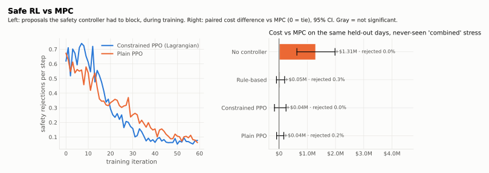
</picture>

Constrained PPO (NumPy, Lagrangian on safety rejections) **ties MPC on held-out days** (−$0.00M, CI −0.06 to +0.05) with **zero rejected proposals**, and stays statistically tied on a stress scenario it never saw. The first version failed to learn (≈70% of proposals rejected); [what changed](docs/14_safe_rl_design.md).

### 5. Does a lender gain by gaming the liquidity auction?

<picture>
  <source media="(prefers-color-scheme: dark)" srcset="docs/assets/auction-incentives-dark.svg">
  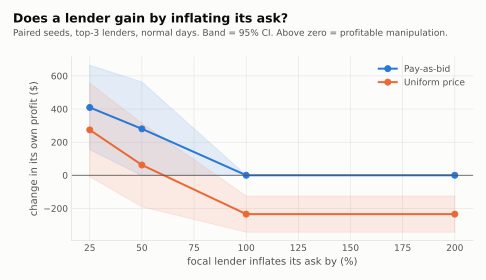
</picture>

### 6. Scale

<picture>
  <source media="(prefers-color-scheme: dark)" srcset="docs/assets/scaling-dark.svg">
  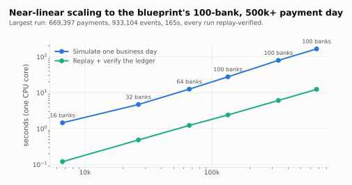
</picture>

<details>
<summary><b>More: forecasting with honest uncertainty · netting optimality · strategic behaviour</b></summary>

<picture>
  <source media="(prefers-color-scheme: dark)" srcset="docs/assets/forecasting-dark.svg">
  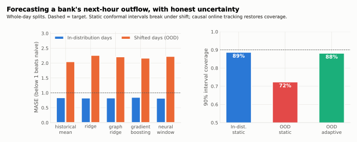
</picture>

<picture>
  <source media="(prefers-color-scheme: dark)" srcset="docs/assets/netting-gap-dark.svg">
  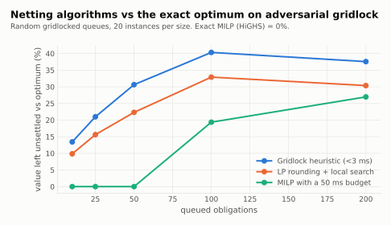
</picture>

**Strategic behaviour (16 paired seeds):** when every bank recycles incoming liquidity, the largest bank profits by defecting (unstable). "Everyone pays early" has the lowest system cost, but its stability is statistically inconclusive. No Nash equilibrium is claimed.
</details>

---

## What makes it realistic

| Real-world fact | In ATLAS-Σ | Source |
|---|---|---|
| FedNow network limit raised $1M → **$10M** (Nov 12, 2025); banks set lower limits | per-bank limits from {$0.5M, $1M, $5M, $10M} | [FRB Services](https://www.frbservices.org/news/communications/111225-fednow-transaction-limit-increase) |
| RTP network limit **$10M** | cap on RTP payments | [The Clearing House](https://prnewswire.com/news-releases/higher-10-million-rtp-network-transaction-limit-empowers-new-uses-302321724.html) |
| Fed daylight-overdraft fee: **50 bp** on the *uncollateralized* overdraft, minute-by-minute over the 1,291-minute day | exact formula, tested against the Fed's worked example | [Fed PSR guide](https://www.federalreserve.gov/paymentsystems/psr_guide.htm) |
| Customer transfers cut off before interbank transfers | 18:00 vs 18:30 ET | modeled on Fedwire practice |
| Liquidity-saving systems fund closing positions | pre-cutoff and pre-close funding cycles | modeled assumption |
| Banks' daily gross flows roughly offset; liquidity stress comes from *timing* | Sinkhorn-balanced expected flows + autocorrelated intraday activity | calibration choice |

Everything that is an assumption is labeled as one in the code's rule registry and in [`docs/23`](docs/23_realism_and_calibration.md), including the biggest caveat: real FedNow settles in the same Fed master account as Fedwire.

---

## Try it

```bash
python3 -m venv .venv && source .venv/bin/activate          # Python 3.12+
pip install -r requirements-lock.txt && pip install --no-deps -e .
pytest -q                                                   # 152 tests
uvicorn atlas.api.app:app --port 8000                       # API + demo runs → http://localhost:8000/docs
cd frontend && npm ci && npm run dev                        # Command Center → http://localhost:3000
```

Or `docker compose up --build` (add `--profile observability` for Prometheus + Grafana).

<details>
<summary><b>Five lines of Python: stress a day and compare treasuries</b></summary>

```python
from atlas.scenario import generate_scenario
from atlas.sim import SimulationSettings, run_day
from atlas.stress import build_scenario
from atlas.control import MPCController

day = generate_scenario(seed=11)                                     # synthetic, deterministic
base = run_day(day, SimulationSettings(policy="priority"), build_scenario("combined"))
best = run_day(day, SimulationSettings(policy="multilateral", auction="uniform"), build_scenario("combined"), controller=MPCController())
assert base.verify_replay() and best.verify_replay()                 # every cent re-derived from the event log
print(base.metrics["large_value"]["settlement_rate_value"], "→", best.metrics["large_value"]["settlement_rate_value"])
```
</details>

<details>
<summary><b>Reproduce every number in this README</b></summary>

```bash
python -m atlas.benchmark --preset standard   # 240 runs, policy comparison + cost sensitivity
python -m atlas.benchmark --preset extended   # 10 seeds × 11 stresses
python scripts/auction_study.py               # E4 incentives
python scripts/train_safe_rl.py               # E7 constrained PPO vs MPC
python scripts/generate_research_artifacts.py # forecasting, game theory, netting optimality
python scripts/scaling_study.py               # up to 100 banks
python scripts/make_figures.py && python scripts/build_site.py
```
Every result file records seeds, versions, Python, platform and runtime.
</details>

---

## Inside the box

<details open>
<summary><b>Capabilities</b></summary>

| Layer | What is implemented |
|---|---|
| **Financial core** | Integer minor-unit money; explicit payment lifecycle with settled finality; collateral and funding facilities |
| **Trust** | Append-only SQLite event store with a SHA-256 hash chain; strict ledger that checks every event's before-balances and cash conservation; deterministic replay |
| **Rails** | RTGS (priority queue, collateralized/uncollateralized intraday credit, PSR fee); LSM (partial multilateral netting, closing-position funding); FedNow-style and RTP-style instant rails with per-bank limits |
| **Messaging** | ISO 20022 `pacs.008/009/004` normalization (XXE-safe, provenance kept) and `camt.053` statements reconciled to the ledger |
| **Agents & stress** | 6 bank release strategies; empirical game-theoretic analysis; 10 shock scenarios recorded as replayable events |
| **Market design** | Sealed-bid intraday liquidity auction: pay-as-bid and uniform price; loans as ledger events |
| **Optimization** | Exact netting MILP, LP rounding, gridlock heuristic (HiGHS); CVaR funding LP; MPC with rebalancing LP + queue MILP |
| **Learning** | Constrained PPO with per-bank Lagrangian safety cost; forecasting with ridge, graph-conditioned ridge, gradient boosting, neural window; split-conformal + adaptive intervals |
| **Analytics** | Betweenness, PageRank, Tarjan SCC gridlock detection, HHI (cross-checked against NetworkX) |
| **Product** | FastAPI (RBAC, replay verification, counterfactuals, grounded analyst Q&A, Prometheus); Next.js + D3 Command Center (9 screens); Docker; CI; GitHub Pages explorer |
</details>

<details>
<summary><b>Repository map</b></summary>

```text
src/atlas/   domain · simulation · rails · liquidity · ledger · store · iso20022 · scenario · sim · settlement
             market · agents · stress · network · control (safety, MPC, safe RL) · optimize · forecast · analyst · benchmark · api
frontend/    Next.js Command Center
results/     every benchmark and research artifact (JSON + Markdown), plus trained policies
docs/        specifications 01–23: architecture, ledger, rails, algorithms, formulations, results, realism, limitations
scripts/     studies, figure and site builders, demo recorder
```
</details>

<details>
<summary><b>Honest limitations</b></summary>

- Synthetic data only; cost weights are assumptions (hence the 27-model sensitivity check).
- FedNow is modeled with its own liquidity pool; in reality it shares the Fed master account, so cross-rail fragmentation is overstated for FedNow.
- Instant rails run only inside the large-value business day; intraday transfers are instantaneous.
- No defaults, net debit caps, or PSR fee waiver. Auction loans that can't be repaid roll overnight.
- LSTM / Temporal Fusion Transformer not implemented (no deep-learning framework in the dependency set).
- The analyst is deterministic retrieval, not a generative model.

Full register: [`docs/20_known_limitations.md`](docs/20_known_limitations.md).
</details>

---

<sub>Engineering rules: financial correctness before visuals · integer money · every state change is an event · every run reproducible from (config, seed, versions) · every automated action passes the safety controller · every claim compared to a baseline with paired statistics · nothing synthetic presented as real. Decisions D-001 to D-025 in [`DECISIONS.md`](DECISIONS.md).</sub>

<sub>© Akilan Manivannan. All rights reserved.</sub>

## Citing

If ATLAS-Σ or the NEXUS-PAY benchmark is useful in your work, use GitHub's **Cite this repository** button (generated from [`CITATION.cff`](CITATION.cff)).
